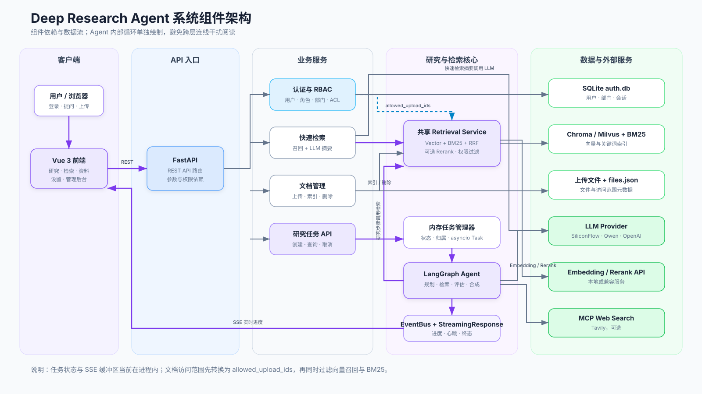

# Deep Research Agent

[中文说明](README.zh-CN.md) · [Development guide](docs/development.md) · [API](docs/api.md) · [Permissions](docs/permissions.md)

An Agentic RAG application for researching questions across a document collection. It decomposes a question, retrieves evidence, critiques retrieval quality and produces a source-linked report.

**Status:** local-development and single-instance prototype, not an audited production service. The application and detailed guides currently focus on Chinese-language use.



## What the project demonstrates

- **Retrieval:** vector search, BM25, reciprocal-rank fusion and optional reranking.
- **Research workflow:** decomposition, parallel or dependent steps, bounded retries and multi-hop context.
- **Traceability:** source IDs, citations and live execution events through FastAPI SSE.
- **Access boundaries:** optional login, roles, document visibility and task ownership checks.
- **Evaluation tooling:** fixed retrieval cases and calculations for Hit@K, MRR, source recall and latency.
- **Application delivery:** Vue 3 interface, document upload, configuration and troubleshooting guides.

## Example workflow

Ask: “Compare how the indexed documents describe stateful agent workflows and retrieval pipelines.”

```text
Question → research plan → permitted documents → hybrid retrieval
         → quality critique → retry or next step → cited report
```

The system can still retrieve incomplete evidence or generate incorrect conclusions. Citations improve inspectability; they do not establish correctness on their own.

## Run locally

Requirements: Python 3.12+ and a Node.js version compatible with `frontend-vue/package.json`.

```bash
git clone https://github.com/albertyuee/deep-research-agent.git
cd deep-research-agent
python3 -m venv .venv
.venv/bin/python -m pip install -e ".[dev]"
cp config/.env.example config/.env
```

Configure the LLM and embedding provider in `config/.env`. Calls may incur charges. The [Chinese guide](README.zh-CN.md) documents Chroma/Milvus, embedding and optional reranking choices. Then run `./start.sh`.

Use only public or synthetic documents for the initial demo. Consult [troubleshooting](docs/troubleshooting.md) if a provider or local service is unavailable.

## Test and evaluate

```bash
.venv/bin/python -m pytest tests -q
cd frontend-vue && npm ci && npm run build
```

From the repository root, after configuring and indexing the public evaluation corpus:

```bash
.venv/bin/python scripts/evaluate_retrieval.py \
  --top-k 10 --output reports/retrieval-evaluation.json
```

Acceptance thresholds are **not measured accuracy results**. No benchmark improvement or production usage is claimed here. See [evaluation reporting](docs/evaluation-reporting.md) for a reproducible comparison plan.

The optional RGB Chinese multi-hop dataset is restricted to non-commercial evaluation under its upstream license. Keep dataset rights separate from application-code licensing.

## Design trade-offs and limitations

- SQLite authentication data and in-memory tasks simplify setup but need shared infrastructure for multi-instance deployment.
- Authentication is disabled by default for local demos. Enable it, set a strong administrator password and require HTTPS before remote use.
- Model critique is a heuristic, not a correctness guarantee.
- Additional research steps increase provider latency and cost.
- Uploaded content and retrieved passages may be sent to external providers.
- Rate limiting, auditing, backups and production security review remain deployment responsibilities.

## Implementation map

| Area | Entry point |
| --- | --- |
| Agent orchestration | `research_agent/graph.py` |
| Retrieval and ranking | `research_agent/retrieval/` |
| Permission model | `backend/auth.py` |
| Evaluation | `research_agent/evaluation/` |
| Regression tests | `tests/` |

## License

MIT. See [LICENSE](LICENSE). Third-party corpora retain their original licenses.
